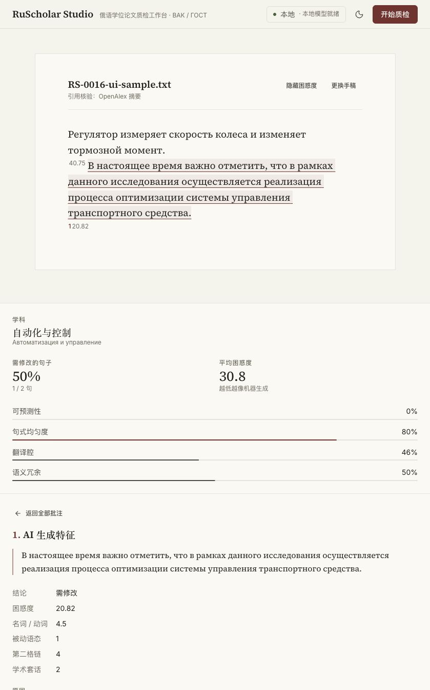

# RS-0016：Claude 三轮改动本地审查（2026-11-04）

执行：codex@mac。Owner 授权：按照 Claude 的思路复核并本地修正。结论：三轮改动已整合、关键运行问题已修正，可进入 Owner 验收；当前任务分支为 `agent/codex/RS-0016-claude-local-review`，没有推送或合入 main。

## 保留的设计

整合 Claude 的 `0c10cf5`（依赖、PPL、降级和安全）、`7faad33`（服务统一）、`249f24a`（打包、MCP 拆分、前端重构），并保留本地迁移、配置和 CI 修复。沿用统一 settings/model_registry、诊断流水线、17 个 MCP 工具的分组模块，以及浅色纸面、衬线排版、红色标记的新界面。

## 已复现并修正的问题

| 问题与影响 | 修正与验证 |
| --- | --- |
| wheel 缺 MCP tools 子包，脱离源码无法导入 | 使用递归包发现；核心/可选依赖复用 requirements；隔离安装后实际调用 CLI |
| asyncio 请求取消会提前释放锁，原生 llama.cpp 线程仍在运行 | 所有本地推理统一进入工作线程 RLock；取消并发回归通过，模型重置也等待原生调用结束 |
| 纯云端操作加载本地大模型，配置密钥/引擎选择不一致 | Web/MCP 共用配置解析和凭据回退；纯云端不加载本地模型，本地模式忽略残留云端密钥 |
| TTL 过期项读取后复活，诊断会话可重复消费 | 读取前清理；SSE 启动前取出会话；TTL 和单次消费回归通过 |
| 全上下文 PPL 转 float64 产生过大临时数组 | 保留 NumPy 算法，按 16 行分块；精度、输入只读及临时内存检查通过 |
| 停止/重置后旧的准备请求仍可能启动或回写 | 分类、会话、文献请求接收取消信号；运行编号隔离过期回调；真实浏览器停止与重启通过 |
| 停止后显示没有问题，BibTeX 被当成全文索引，混合模式隐私提示错误 | 明确未完成状态；按 bibtex_keys/pdf_keys 区分元数据与全文；说明混合模式会向云端发送句子 |
| VAK 云端模型别名及推理前缀解析不一致 | 复用云端映射和 JSON 清理；回归通过 |

## 验证证据

| 项目 | 本地结果 |
| --- | --- |
| Python 3.13.12 自动测试 | 111 passed / 1 deselected；新增 12 项集成回归；pip check 通过 |
| 前端 | 临时目录 npm ci、严格 lint、配置 8/8、API 4/4、TypeScript/Vite build 通过；dist 已复制回项目 |
| MCP | 源码与隔离 wheel 安装均列出 17 工具并调用工作流；17 个输入 schema 与原本地基线一致 |
| 真实 Qwen Web | 自写两句样例：PPL 40.75（early_exit）、17.89（flagged）；init/result/done 完整，约 39 秒 |
| 浏览器 | 实际导入、准备阶段停止、等待不自动重启、重新开始、完整结果、PPL 显示、标注详情通过 |
| 文献状态 | 实际 BibTeX 注册返回 bibtex_keys=[synthetic]、pdf_keys=[]；不再显示为全文核验 |
| PPL 算子基准 | 合成 logits 16×150000，3 次中位数：参考 0.24130 秒、分块向量化 0.00654 秒；NLL 误差 0，临时峰值约 18 MB |

算子基准约 36.9 倍仅代表上述合成计算，不能外推为模型推理或整个诊断的加速倍数。真实长文性能仍待 RS-0006；质量与 AI 风格识别准确率仍待 RS-0010。浏览器样例使用换行分句，第二句 PPL 为 20.82；API 样例使用空格连接，不能直接把这两个输入当成同一结果。

## 运行与剩余范围

本机后端使用 `~/miniforge3/bin/python3`，稳定监听 `http://127.0.0.1:8000/`，未启用热重载。源码前端已构建。重启方式见开发指南和交接。

- wheel 已验证 API/MCP 的安装与导入；完整网页目前使用源码下 frontend/dist，未验收独立 UI 安装包。
- 云端真实服务调用、Windows 脚本实机、Python 3.10/3.12 新矩阵和 GitHub CI 本轮未运行。
- npm audit 命令等待 45 秒超时；同一锁文件向 npm 官方 bulk audit 接口查询返回 HTTP 200，报告 1 项 moderate：开发依赖 minimatch 10.2.5（公告范围 <11.0.1）。eslint/typescript-eslint 当前约束为 10.x，未强制跨主版本覆盖。zod 在原约束内升至 4.6.7，此次 bulk 结果没有其 high 告警。
- RS-0005/0007/0008/0009 的实现已随三轮接入；各任务最终验收仍由 Owner 按原任务卡确认。未改变 RS-0014 公开历史清理状态。

细节与变更归属以本任务 Git diff/merge 提交为准；模型、密钥、私人论文和数据均未纳入提交。
