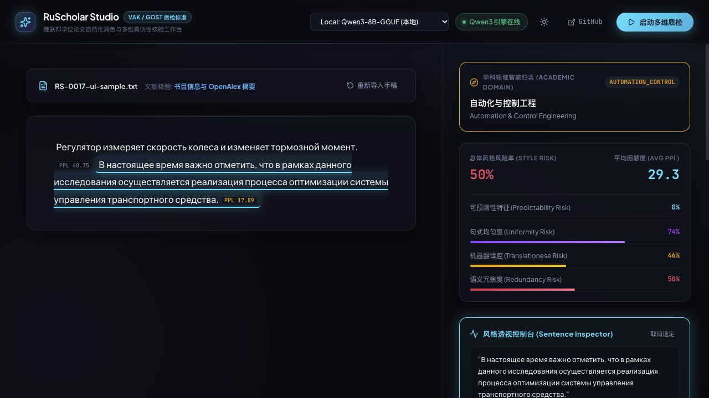

# RS-0017：原界面恢复与新后端适配（2026-11-04）

Owner 已批准恢复原前端、适配新后端并推送或合入主干。视觉基线为 Claude 三轮改动之前的 bd599dc：深色玻璃双栏、顶部引擎选择与密钥栏、手稿句子标记、四项风险指标、过滤标签、逐句详情与浅色切换。

## 最终行为

保留 RS-0016 的新后端、服务整合、打包、MCP 和原生推理保护。原界面改用集中 API 与 useDiagnosis / useModelStatus，接收 nlp_backend、风险汇总、负数 index 的文献告警与单次 session_id；不恢复旧的重复接口实现。

- 模型下载继续 POST + 流式读取，不恢复旧的 GET EventSource。
- 停止、重置、卸载和更换手稿会取消前一轮请求；上传失败显示后端错误，上传中的手稿不能启动诊断。
- cloud-flash 与新后端的模型别名一致；纯云端/混合模式明确提示发送句子。
- BibTeX 与 PDF 全文按后端返回区分：已选未注册、书目信息、全文索引与失败状态分别显示。
- 保留原界面的深度扩展区域；未接入网页的四个按钮明确禁用。
- 默认深色，记住用户选择；窄窗口自动上下排列，避免原先 480px 最小宽度挤出页面。

## 本地验证

| 检查 | 结果 |
| --- | --- |
| 后端自动测试 | 111 passed / 1 deselected（本机 Python 3.13.12） |
| 前端 | lint、配置 8/8、API 6/6、TypeScript/Vite build 通过；依赖和构建缓存均在 OneDrive 外 |
| 新增接口检查 | 手稿上传取消/413 提示；模型 POST 下载跨分块流进度解析 |
| 真实 Qwen 与浏览器 | 导入自写俄语两句及合成 BibTeX，准备阶段停止后保持停止；重启完成两句诊断，PPL 40.75 / 17.89，平均 29.3，风险比例 50% |
| 界面适配 | 句子点击显示词法指标、解释和改写；BibTeX 显示书目信息与 OpenAlex 摘要；主题切换正常；浏览器未记录 error/warn |

截图使用自写样例，不含私人论文。frontend/dist 已更新，后端继续监听 http://127.0.0.1:8000/，无热重载。RS-0016 的运行证据仍适用；本轮未改变后端算法。模型实际输出并不代表诊断准确率已经验收。

## 发布及范围

已通过 [PR #1](https://github.com/Tanue-Hou/RuScholar-Studio/pull/1) 发布至 main，合并提交 44525aa，本地主干已同步。[CI #2](https://github.com/Tanue-Hou/RuScholar-Studio/actions/runs/41823277142) 的前端、Python 3.10、Python 3.12 三项均成功。不重写历史、不上传模型、密钥或私人论文。

Windows、真实云端和长文准确率评测仍单列；RS-0016 记录的开发依赖 minimatch moderate 告警本轮未变更。
