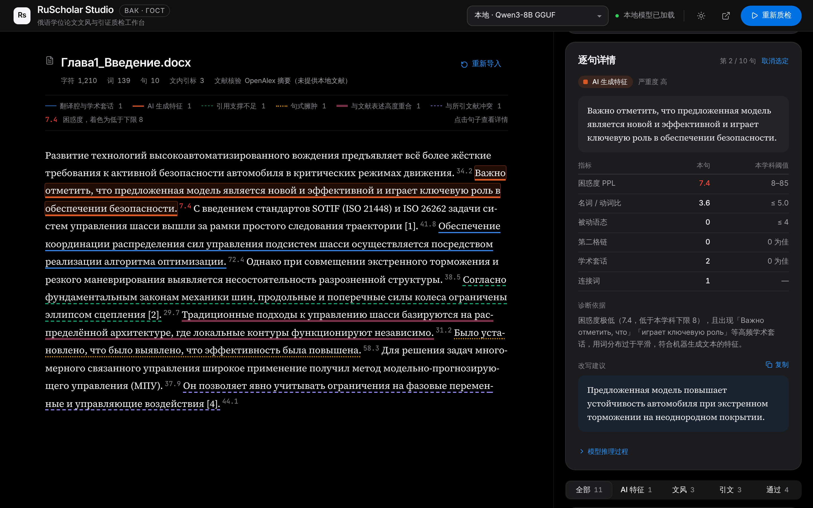
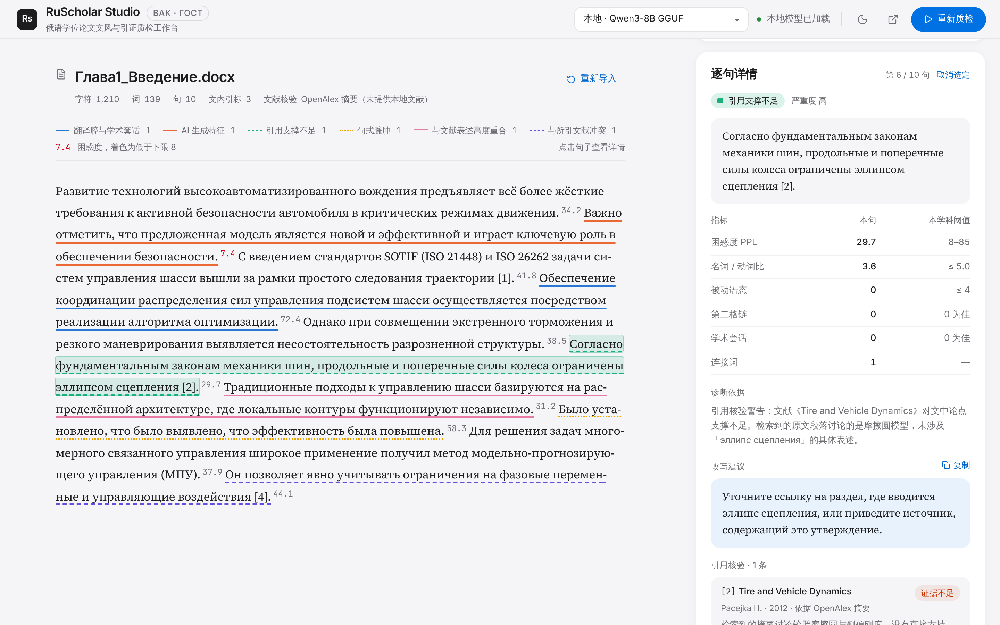
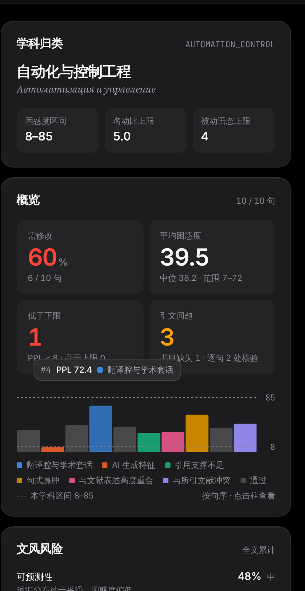
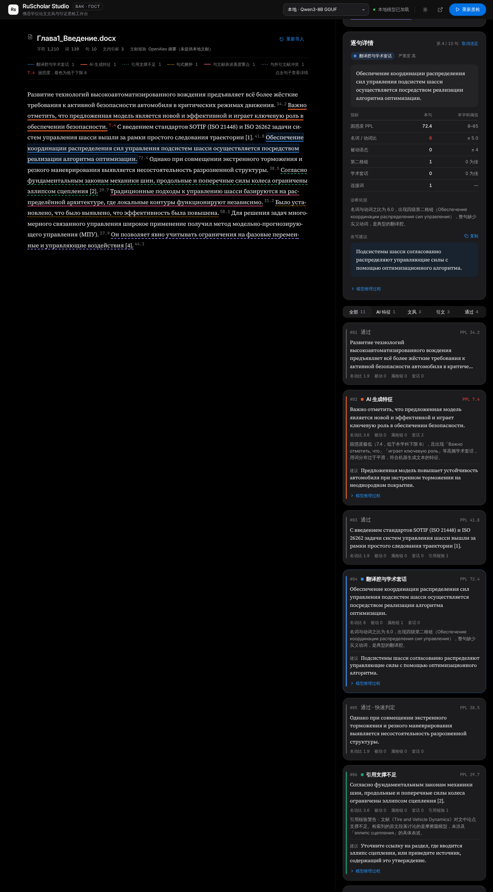
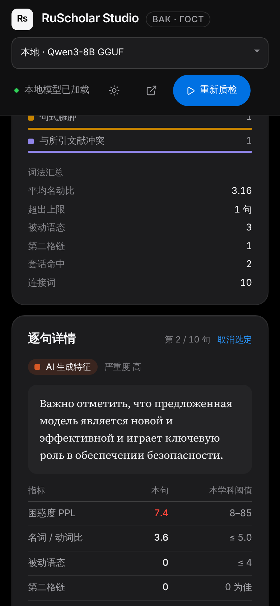

# RS-0018：原界面去 AI 味、苹果式质感与问题分色（2026-11-04）

基线为 RS-0017 恢复的双栏驾驶舱。布局与交互不变；替换材质与文案，补充后端已提供但界面未展示的数据，并按问题类型分色。

## 迭代经过
| 轮次 | Owner 要求 | 结果 |
| --- | --- | --- |
| 1 | 在原 UI 基础上减少 AI 味、高级感、信息详实，渲染参考图 | 去霓虹/渐变/玻璃/emoji/双语括注；补充学科阈值、概览、困惑度分布、词法汇总、阈值对照表 |
| 2 | 增加颜色，不同颜色代表不同问题 | 六类问题各有颜色与线型，贯穿手稿、图例、分布图、问题构成、卡片与详情 |
| 2 | 要有苹果官网那种高级感 | 纯黑 / #f5f5f7 画布、18px 大圆角卡片、收紧字距的半粗标题、大号数字、胶囊蓝色主按钮、分段控件标签、半透明顶栏 |
| 3 | 字体使用苹果官方字体 | 全部改用苹果系统字体：SF Pro（含手稿正文）、苹方、SF Mono；移除 Inter / Source Serif 4 / JetBrains Mono 打包依赖；苹果字体授权禁止再分发，故不打包，通过 `-apple-system` 调用 |

## 问题分色
| 问题类型 | 颜色（深 / 浅） | 手稿下划线 |
| --- | --- | --- |
| 翻译腔与学术套话 | 蓝 `#3987e5` / `#2a78d6` | 实线 |
| AI 生成特征 | 橙 `#d95926` / `#eb6834` | 粗实线 |
| 引用支撑不足 | 青绿 `#199e70` / `#1baf7a` | 虚线 |
| 句式臃肿 | 黄 `#c98500` / `#eda100` | 点线 |
| 与文献表述高度重合 | 品红 `#d55181` / `#e87ba4` | 双线 |
| 与所引文献冲突 | 紫 `#9085e9` / `#6250d6` | 虚线 |

- 颜色取自 dataviz 参考分类色板，按固定顺序分配；跳过第 6 槽绿色，避免与「通过」混淆。「通过」改为中性灰。
- 验证脚本（相邻对）：深色、浅色全部通过；浅色下黄/青绿/品红对比度低于 3:1，按规则以可见文字标签补偿。
- 六色无法两两区分（色板只保证 3 色），因此每处颜色都配问题名称，手稿中另以线型区分；最易混的蓝/紫、品红/青绿线型不同。
- 单一来源：`frontend/src/lib/issues.ts`（名称、颜色键、线型、顺序）。

## 后端
SSE `init` 新增 `calibration {ppl_low, ppl_high, nv_ratio_max, passive_max}`（只增字段），取自 `calibration_config.json`，与流水线实际阈值一致；`docs/02-design/architecture.md` 已同步，测试 `test_init_event_carries_discipline_calibration`。

## 参考图（示例数据，非私人论文）
深色，选中第 2 句（AI 生成特征）：

浅色，选中第 6 句（引用支撑不足）：

学科与概览（分布图悬停）：

完整右栏（1440×2600）：

手机 390px：

## 验证
| 检查 | 结果 |
| --- | --- |
| 后端 | 112 passed / 1 deselected（云端容器 Python 3.13） |
| 前端 | lint、test:api 6/6、test:config 8/8、build 通过；字重仅 400/500/600 |
| 浏览器（Playwright，真实后端托管构建产物，`/api/*` 用示例数据） | 1440 深/浅色、1440×2600、390 移动端：无 console error/warning，无横向溢出；悬停提示与点选定位正常 |

说明：容器内无苹果字体，截图中 SF Pro 由 Inter 代替；在 macOS / iOS 上显示 SF Pro、苹方与 SF Mono。第三轮后页面无任何 `@font-face`，构建产物不含字体文件。

未验证：真实 Qwen 推理下的完整流程、真实云端、Windows。
