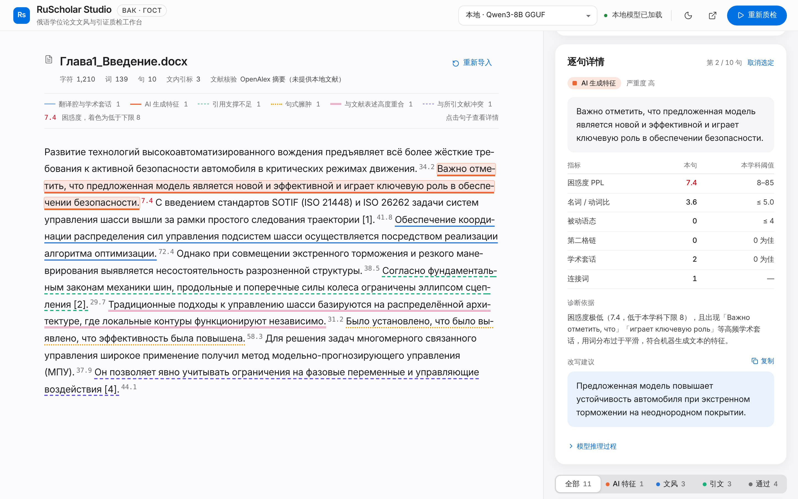
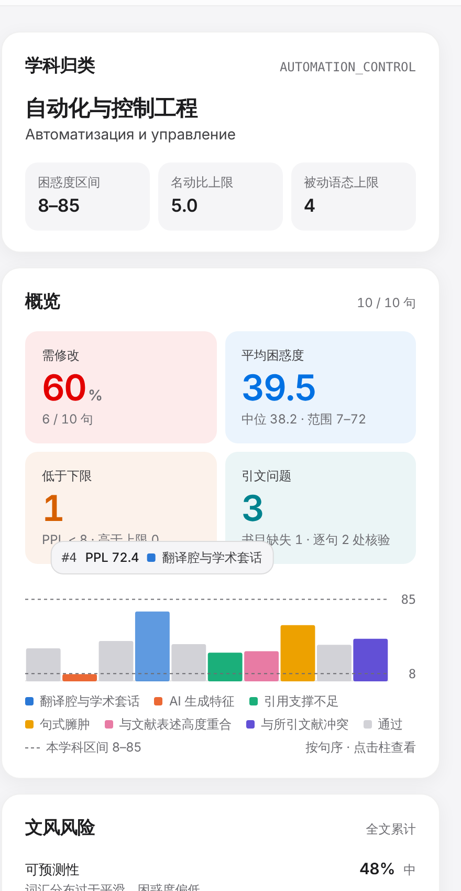
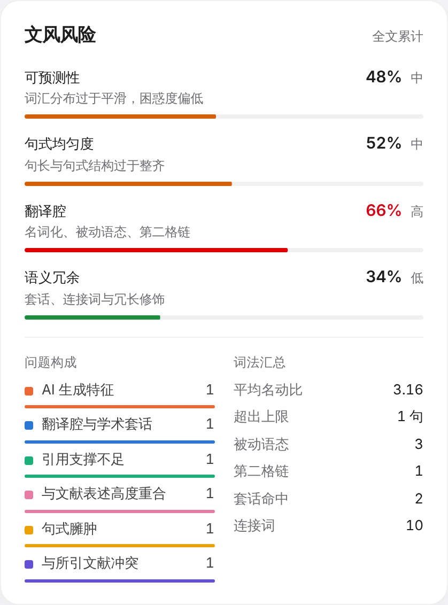
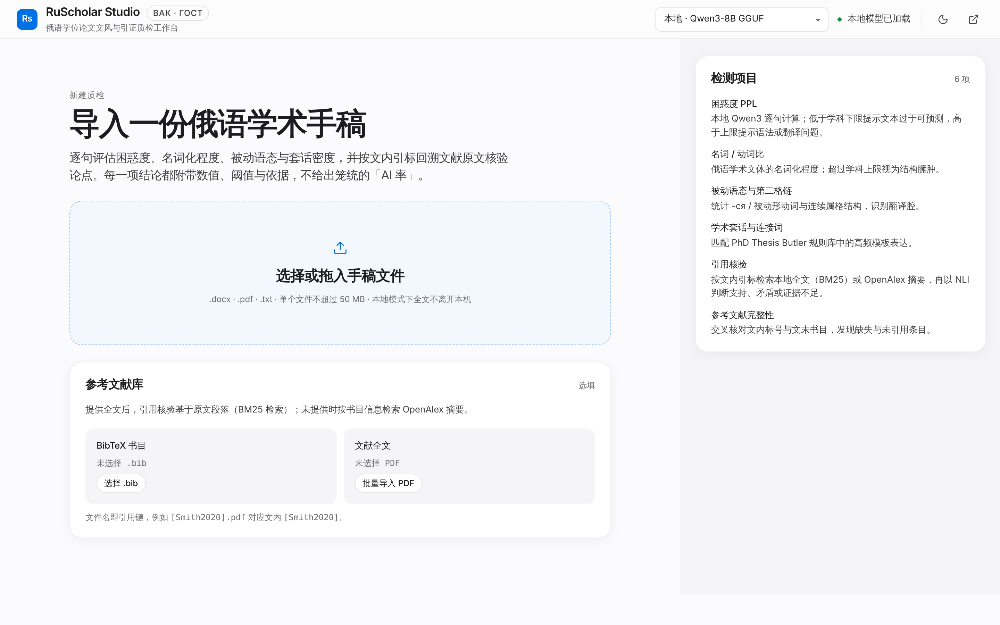
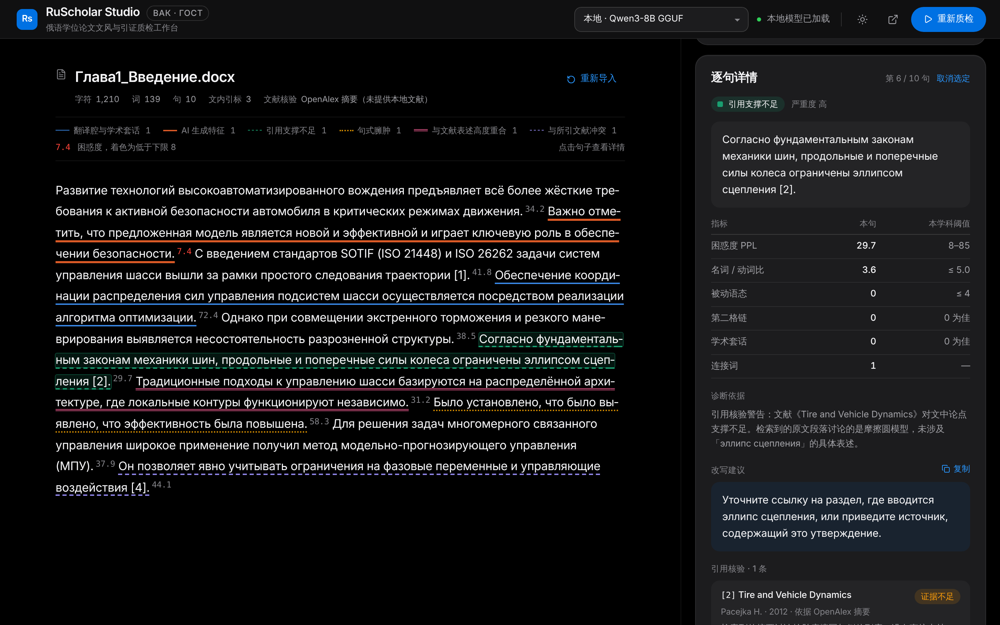
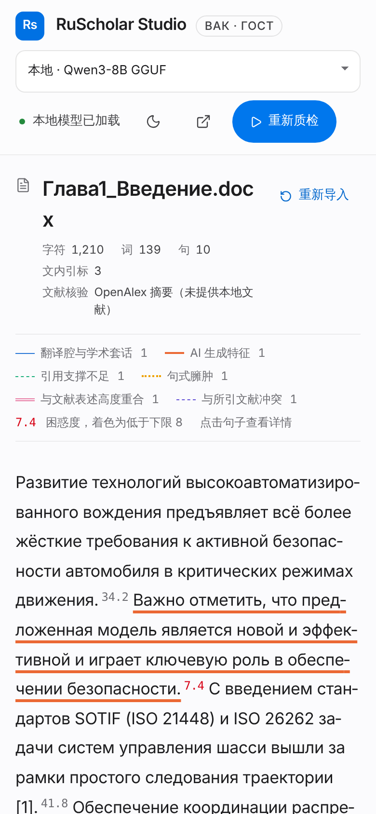

# RS-0019：整体代码审查与明快配色（2026-11-04）

## 一、代码审查

范围：`main` 8ea5a98 的 `backend/`、`services/`、`naturalization_layer/`、`mcp_server/`、`frontend/src/`。

基线状况：`pytest` 112 passed / 1 deselected；前端 lint、API 6/6、配置 8/8、构建通过；pyflakes 无未定义名称等硬错误。

### 问题（按严重程度排序；本任务只报告，修复需另行批准）

| # | 严重度 | 位置 | 问题 | 复现 / 依据 | 建议 |
| --- | --- | --- | --- | --- | --- |
| 1 | **高（数据丢失）** | `naturalization_layer/model_downloader.py` `download_model` | 拿目标文件与 8B 的固定大小 `EXPECTED_SIZE` 比较，不一致就直接 `os.remove`。当 `resolve_model_path` 解析到用户的 4B 模型，或 `RUSCHOLAR_MODEL_PATH` 指向自定义 GGUF 时，调用下载（MCP `thesis_download_model_tool`；`check_model_installed` 报「大小不符」会引导调用它）会**删除用户可用的模型**，再把 8B 下载成原文件名 | 已在隔离目录复现：4B 文件被删，下载目标为 `Qwen3-8B-Q5_K_M.gguf`，保存名为 `Qwen3-4B-Q5_K_M.gguf` | 只在路径确为 8B 目标时校验大小；不删除未知文件，改为下载到 8B 默认路径；或要求显式确认 |
| 2 | 中 | 同上 | 并发下载共用 `dest.tmp`，第二次调用会删除第一次正在写的临时文件（Web `POST /api/download_model` 与 MCP 都能触发） | 代码路径：`if os.path.exists(tmp_path): os.remove(tmp_path)` | 进程内加下载锁；临时文件名加唯一后缀 |
| 3 | 中 | `backend/main.py` `/api/check_model` | 只检查文件是否存在。截断或大小不符的文件会被前端显示为「本地模型已加载」，随后加载失败；与 MCP `check_model_installed`（检查大小）口径不一致 | 代码对比 | 复用 MCP 的检查逻辑，返回 `{exists, size_ok}` |
| 4 | 中 | `naturalization_layer/rag_retriever.py` `fetch_openalex_abstract` | OpenAlex 对无开放获取版本的论文返回 `best_oa_location: null`，`.get()` 在 `None` 上报错，被 `except` 吞掉，**有效结果被丢弃**，引用核验退化为「证据不足」或跳过 | 已用模拟响应复现：`null` → 返回 `None`；有值 → 正常返回 | `(work.get("best_oa_location") or {}).get("pdf_url")`，`open_access` 同理；补测试 |
| 5 | 中（隐私说明） | 引用核验流程 | 本地模式下，文末书目条目（标题、作者、年份）仍会发送到 OpenAlex；README 写「未发表的学术手稿完全离线处理」 | `perform_nli_citation_audit` 不区分引擎，均调用 `resolve_reference` | 在界面与 README 明示；增加「仅本地文献」开关 |
| 6 | 低 | `python backend/main.py` 启动方式 | 脚本模式下 uvicorn 按 `backend.main:app` 再导入一次模块，模块级代码（挂载静态目录、打印警告）执行两次 | 代码路径 | 脚本模式直接传 `app` 对象；或文档统一推荐 `ruscholar-web` |
| 7 | 低（整洁度） | 多处 | 37 处未使用的 import；`report_service.py` 未使用变量与无占位 f-string；`translationese_risk.py` 未使用变量 | pyflakes | 用 autoflake 清理，CI 加 pyflakes |
| 8 | 低（可维护性） | `frontend/src/App.tsx` 755 行 | 仍是单文件；前端只有 API 与配置测试，没有组件测试（RS-0007 仍待办） | — | 按区域拆分组件；补 Vitest + Testing Library |

### 做得好的地方
- 服务层收敛后，Web 与 MCP 共用同一套诊断、引用与模型管理逻辑。
- 本地推理在 `registry.run_local` 中串行化，客户端断开不会提前释放锁。
- 前端停止、重启、卸载会取消前一轮请求，回调都检查是否属于当前这一轮。
- SSE `init.calibration` 让界面显示的阈值与流水线判定一致。

## 二、明快配色

在 RS-0018 的苹果式界面上提亮，布局、交互、问题分色与苹果系统字体不变。

| 方面 | 之前 | 现在 |
| --- | --- | --- |
| 默认主题 | 深色（纯黑） | **浅色**；画布 `#fbfbfd`、卡片纯白、文字更深更清晰。用户手动选过的主题仍会被记住 |
| 概览四格 | 灰底，数字白/黑 | 按含义着色的淡底与彩色大数字：需修改红、平均困惑度蓝、低于下限橙、引文问题青绿 |
| 文风风险条 | 灰 / 橙 / 红 | 低 = 绿、中 = 橙、高 = 红 |
| 筛选标签 | 纯文字 | 每类前加色点（AI 特征橙、文风蓝、引文绿、通过灰），与问题分色一致 |
| 上传区 | 灰底灰虚线 | 淡蓝底 + 蓝色虚线，悬停加深 |
| 标识 | 黑白方块 | 蓝色圆角方块（应用图标风格） |
| 选中高亮 | 灰 | 淡蓝 |

对比度：彩色数字（34px 大字）叠在各自淡底上，浅色 3.5–4.3:1、深色 4.3–6.5:1，均高于大字 3:1 要求。

## 参考图（示例数据；截图环境无苹果字体，SF Pro 由 Inter 代替）
浅色（默认），选中第 2 句：

学科与概览：

文风风险与问题构成：

导入页：

深色：

手机 390px：

## 验证
| 检查 | 结果 |
| --- | --- |
| 后端 | 112 passed / 1 deselected |
| 前端 | lint、test:api 6/6、test:config 8/8、build 通过 |
| 浏览器（Playwright，`/api/*` 示例数据） | 浅色 1440、浅色 1440×2600、深色 1440、浅色 390 移动端：无 console error/warning，无横向溢出 |
