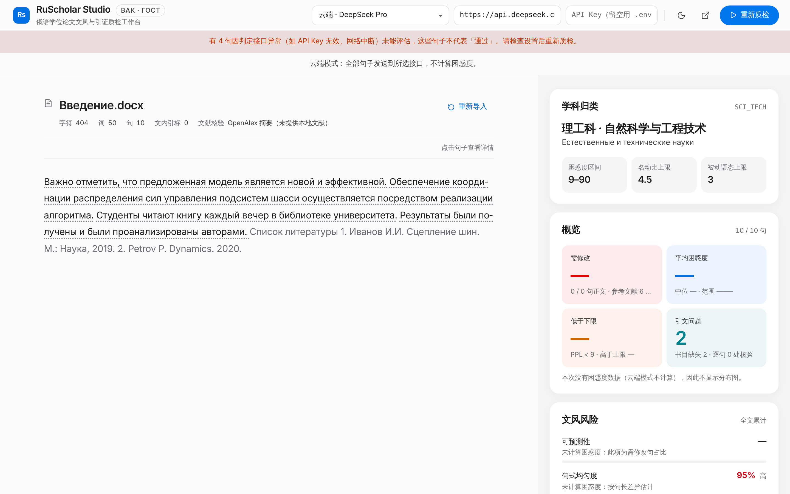
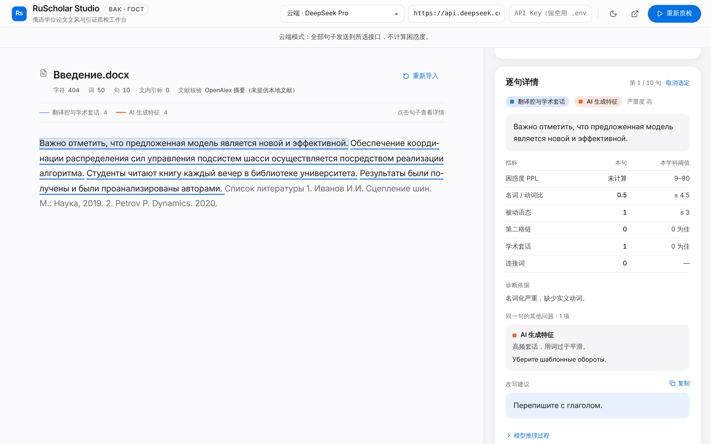

# RS-0020：前端显示数据口径核对与修正（2026-11-05）

方法：用一段 4 句正文 + 文末 2 条书目（被切分为 6 个"句子"）的俄语文本，跑**真实的诊断流水线**，只模拟云端判定接口；把产生的 SSE 事件交给前端渲染，从页面读出实际显示的数字。

## 修正前后对比（页面实际读数）
| 场景 | 指标 | 修正前 | 修正后 |
| --- | --- | --- | --- |
| A：判定接口失败 | 需修改 | 0%（0/10 句，全部「通过」） | **—**（0/0 句正文 · 参考文献 6 条免检 · 4 句未判定） |
| A | 筛选标签 | 通过 10 | 通过 0 · **未判定 4**，并有醒目提醒 |
| A | 可预测性 | 0% 低 | **—**（说明：未计算困惑度，此项为需修改句占比） |
| B：每句同时有翻译腔 + AI 特征 | 需修改 | 40%（4/10） | **100%（4/4 句正文）** |
| B | AI 特征 | 0 | **4** |
| B | 文风 | 4 | 4 |
| B | 翻译腔风险 | 16.7% | **42%** |
| B | 语义冗余 | 20% | **50%** |
| B | 平均名动比 | 1.5 | **3.75** |

## 仍需注意（未在本任务修改）
- 判定模型只按提示词中的类型名返回问题；如果返回其他名字，界面会显示「其他：类型名」并归入「文风」。
- 本地模式快速判定句的 PPL 仍是前 6 个词元的估计，只做了标注与区分显示；如需完全一致，需改为对这些句子补算整句 PPL（会增加本地推理时间）。
