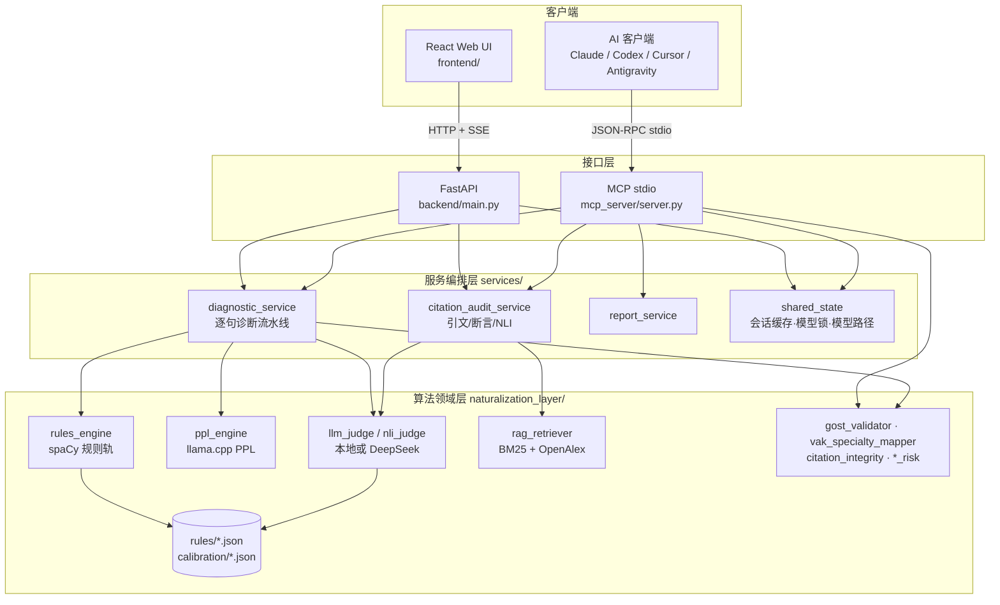

# 系统架构

## 1. 分层

**依赖方向约束**：接口层 → 服务层 → 领域层，单向。领域层不得 import FastAPI / MCP / services。

## 2. 核心数据流：Web 逐句诊断

1. `POST /api/upload` 解析文档 → 文本
2. `POST /api/detect_discipline` → 学科簇（决定规则集与校准阈值）
3. （可选）`POST /api/upload_references` → 按 `session_id` 缓存 BibTeX、建立 BM25 索引
4. `POST /api/session` → 在内存登记文本与引擎参数，返回 `session_id`
5. `GET /api/diagnose?session_id=` → SSE：
   - `init`：`{total_sentences, discipline}`
   - `result`：每句一条（引文完整性全局告警用负数 index 先推送）
   - `done`：汇总
   - `error`
6. 单句处理顺序：参考文献区免检 → 本地文献相似度 → 翻译腔规则 → PPL（早退出）→ 可疑则调用判定器（上下文 ±2 句 + 学科规则）→ 低 PPL 一票否决 → NLI 引文审计覆盖结果
7. 每 3 句一批 `asyncio.gather`；本地模型调用受 `model_lock` 串行保护

### `result` 事件字段（前后端契约，修改须同步 `frontend/src/App.tsx`）
`index, text, ppl, issue_type, severity, explanation, suggestion, think, status(ok|passed|flagged|early_exit), metrics{nv_ratio, passive_count, genitive_chains_count, cliches_count, connectors_count}, predictability_risk, uniformity_risk, translationese_risk, redundancy_risk, citation_audit?`

## 3. HTTP API

| 方法 | 路径 | 说明 |
| --- | --- | --- |
| POST | `/api/upload` | 文档 → 文本 |
| POST | `/api/upload_references` | 注册 BibTeX / 参考文件（form） |
| POST | `/api/detect_discipline` | 学科识别 |
| POST | `/api/session` | 创建诊断会话 |
| GET | `/api/diagnose` | SSE 诊断流 |
| GET | `/api/check_model` | 本地模型是否存在 |
| GET | `/api/download_model` | SSE 下载进度 |
| GET | `/` | 托管 `frontend/dist` |

RS-0011 已在任务分支移除四个未实现的占位路由；后续需 Web 改写/结构/格式能力时重新立项。改写建议可使用现有 MCP，参考文献注册继续走 `/api/upload_references`。

## 4. MCP 工具（17 个，统一返回 `{summary, findings, evidence, next_actions}`）

| 分组 | 工具 |
| --- | --- |
| 路由 | `thesis_route_workflow` |
| 文稿诊断 | `thesis_analyze_manuscript`、`thesis_suggest_revision`、`thesis_export_report` |
| 证据链 | `thesis_extract_claims`、`thesis_classify_evidence_need`、`thesis_bind_evidence`、`thesis_judge_claim_evidence_nli`、`thesis_audit_citations`、`thesis_retrieve_evidence` |
| 合规 | `thesis_map_vak_specialty`、`thesis_audit_vak_gost_compliance` |
| 文献会话 | `thesis_register_references`、`thesis_list_references`、`thesis_clear_references` |
| 模型 | `thesis_check_model_installed`、`thesis_download_model_tool` |

## 5. 配置

环境变量见 `.env.example`：`DEEPSEEK_API_KEY / DEEPSEEK_BASE_URL / RUSCHOLAR_MODEL_PATH / RUSCHOLAR_MODEL_URL / RUSCHOLAR_RULES_PATH / RUSCHOLAR_GPU_LAYERS / RUSCHOLAR_HOST / RUSCHOLAR_PORT`。
`.env` 由 `services/config.py` 在 `services` 包导入时自动读取，已存在的环境变量优先；相对路径按项目根目录解析。端口默认 8000。

## 6. 状态与并发
- 会话与文献缓存：进程内 dict（`active_sessions` 在诊断结束后清除；`session_references` 不清除，RS-0009）
- 模型实例：模块级全局变量懒加载，Web 与 MCP 进程各自持有一份
- 本地推理：`asyncio.Lock` 串行；云端调用并发（每批 3 句）

## 7. 已知设计债
见 `docs/00-overview/project-overview.md` 第 4 节与 `collab/board.md`。
